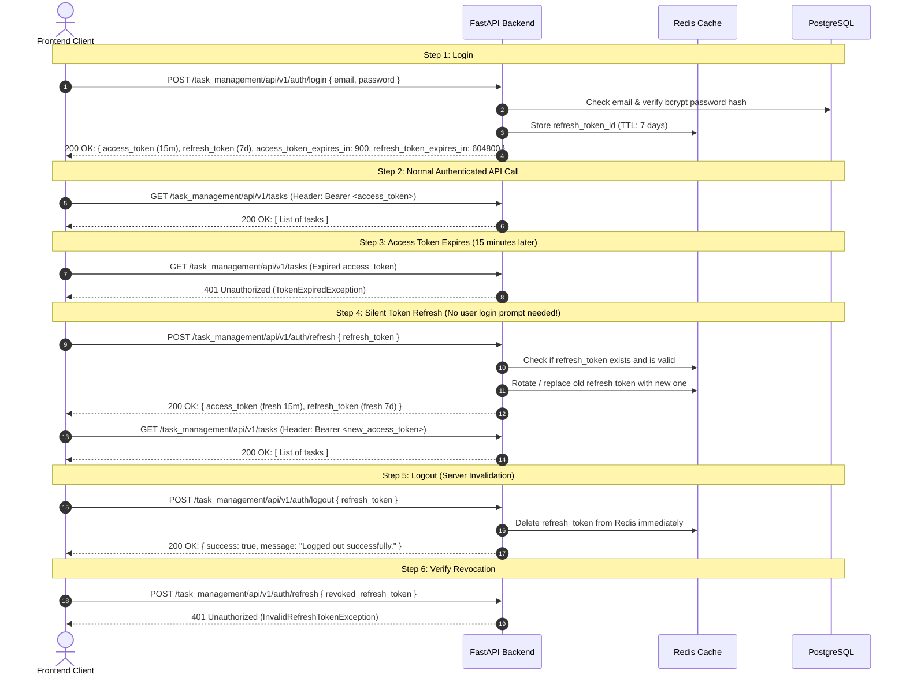

# Workstream Backend Technical Specification (FastAPI)

This document is the official backend architectural and technical specification for the **Workstream** system. It defines the project domain, PostgreSQL relational schema, external infrastructure services, dual-token authentication flow, complete API specifications, Pydantic data validation models, and automated test coverage guidelines.

---

## 1. Describe What the Project Is

**Workstream** is a web-based collaborative project and task management system designed for teams to organize, track, and complete work across shared workspaces.

### System Overview & Core Workflow

The platform revolves around team members collaborating inside **Projects** to execute **Tasks**:

1. **Workspace Collaboration:** Projects act as containers for related deliverables. An Admin creates a project and assigns team members as collaborators.
2. **Task Lifecycle on Kanban Boards:** Each project contains tasks organized across workflow columns (e.g., *To Do*, *In Progress*, *Completed*). Team members can create tasks, assign them to colleagues, set priorities (`low`, `medium`, `high`), assign due dates, and add tags.
3. **Audit Trails & Notifications:** Any status transition, task assignment, or comment generates an **Activity** event. Users receive unread notifications that update in real time.
4. **Member Onboarding:** Administrators invite users via email. The system generates an expiring token (48-hour lifespan). Invited users access an activation form to establish their password and activate their account.
5. **Interactive Server-Rendered UI:** The backend integrates **FastAPI with Jinja2 templates and HTMX** to serve interactive HTML components (such as the invitation activation card) directly from the server.

---

### Role-Based Access Control (RBAC) & Permission Matrix

The application enforces strict authorization through two user roles: **Admin** and **Member**.

#### 1. Administrator (`admin`)

- **Organization & User Control:** Only Admins can invite new members, resend pending invitation emails, change member roles, or delete users from the workspace.
- **Project Ownership:** Only Admins can create new projects, update project collaborator rosters, or delete projects.
- **Workflow Configuration:** Only Admins can create or remove custom Kanban statuses (enforcing a hard system limit of 5 statuses).
- **Super-User Overrides:** Admins can permanently delete any task or remove any inappropriate comment.

#### 2. Team Member (`member`)

- **Project Collaboration:** Members view projects they belong to and view the workspace user directory.
- **Task Execution:** Members can create new tasks, update tasks assigned to them, and move tasks through workflow stages.
- **Discussions:** Members can post comments on tasks and delete their own comments.
- **Personal Profile:** Members can update their personal display name, avatar, and password.

---

### Detailed RBAC Permission Matrix

| Functional Area | Operation / Action | Admin | Member | Enforcement / Business Rules |
| --- | --- | --- | --- | --- |
| **Authentication** | Login & Refresh Tokens | ✅ | ✅ | Open to all active accounts |
|  | Self-Registration | ✅ | ✅ | Defaults to `member` role |
|  | Accept Email Invite & Set Password | ✅ | ✅ | Requires valid, unexpired token |
|  | Logout (Revoke Refresh Token) | ✅ | ✅ | Invalidation handled in Redis |
| **Users** | View User Directory (`GET /users`) | ✅ | ✅ | Any authenticated user |
|  | Invite New User (`POST /users/invite`) | ✅ | ❌ | **Admin Only** (HTTP 403 for Members) |
|  | Resend Invite (`POST /users/resend-invite`) | ✅ | ❌ | **Admin Only** (User must be `pending`) |
|  | View Single User Profile | ✅ | ✅ | Any authenticated user |
|  | Update Own Profile & Password | ✅ | ✅ | Requires matching `current_password` |
|  | Promote / Demote Member Roles | ✅ | ❌ | **Admin Only** (HTTP 403 for Members) |
|  | Delete User Account | ✅ | ❌ | **Admin Only** (HTTP 403 for Members) |
| **Projects** | List Projects (`GET /projects`) | ✅ | ✅ | Any authenticated user |
|  | Create Project (`POST /projects`) | ✅ | ❌ | **Admin Only** (Requires at least 1 collaborator) |
|  | View Project Details & Tasks | ✅ | ✅ | Any authenticated user |
|  | Update Project & Collaborators | ✅ | ❌ | **Admin Only** (Cannot remove member with active tasks) |
|  | Delete Project | ✅ | ❌ | **Admin Only** (Cascades to tasks & comments) |
| **Tasks** | View & Filter Tasks (`GET /tasks`) | ✅ | ✅ | Any authenticated user |
|  | Create Task (`POST /tasks`) | ✅ | ✅ | Generates assignment activity notification |
|  | View Task Details (`GET /tasks/{id}`) | ✅ | ✅ | Includes threaded comments |
|  | Update Task Status & Details | ✅ | ✅ | Generates status change activity |
|  | Soft Archive Task | ✅ | ✅ | Sets `is_archived = true` |
|  | Permanently Delete Task | ✅ | ❌ | **Admin Only** (HTTP 403 for Members) |
| **Comments** | Post Comment on Task | ✅ | ✅ | Appends comment with timestamp |
|  | Delete Own Comment | ✅ | ✅ | Author can delete their own comment |
|  | Delete Another User's Comment | ✅ | ❌ | **Admin Only** (HTTP 403 for Members) |
| **Statuses** | View Workflow Columns (`GET /statuses`) | ✅ | ✅ | Any authenticated user |
|  | Create New Status (`POST /statuses`) | ✅ | ❌ | **Admin Only** (Strict hard cap of 5 statuses max) |
|  | Delete Custom Status | ✅ | ❌ | **Admin Only** (Cannot delete default statuses) |
| **Activities** | View Notification Feed | ✅ | ✅ | Filtered to current user |
|  | Mark Notification(s) as Read | ✅ | ✅ | Single or batch mark-read |

---

## 2. Postgres Schema and Tables

The PostgreSQL database consists of **7 relational tables** with primary keys, foreign keys, and integrity constraints:

### Table 1: `users`

Stores user identity, role, credentials, and invitation lifecycle state.

| Column Name | Data Type | Constraints | Description |
| --- | --- | --- | --- |
| `id` | `UUID` | **PRIMARY KEY**, Default `uuid_generate_v4()` | Unique user identifier |
| `email` | `VARCHAR(255)` | **UNIQUE**, **NOT NULL** | User login email |
| `hashed_password` | `VARCHAR(255)` | **NOT NULL** | Bcrypt password hash |
| `name` | `VARCHAR(150)` | **NOT NULL** | Display name |
| `role` | `VARCHAR(20)` | **NOT NULL**, Values: `'admin'`, `'member'` | System permission role |
| `status` | `VARCHAR(20)` | Values: `'active'`, `'pending'`, `'suspended'` | Account activation state |
| `invite_token` | `VARCHAR(255)` | **UNIQUE**, Nullable | Secure token for activation |
| `invite_expires_at` | `TIMESTAMPTZ` | Nullable | Expiration timestamp (48 hours) |
| `avatar` | `VARCHAR(500)` | Nullable | Avatar image URL |
| `created_at` | `TIMESTAMPTZ` | Default `CURRENT_TIMESTAMP` | Account creation timestamp |
| `updated_at` | `TIMESTAMPTZ` | Default `CURRENT_TIMESTAMP` | Last profile update timestamp |

### Table 2: `projects`

Stores high-level projects grouping tasks and team members.

| Column Name | Data Type | Constraints | Description |
| --- | --- | --- | --- |
| `id` | `UUID` | **PRIMARY KEY** | Unique project identifier |
| `name` | `VARCHAR(200)` | **NOT NULL** | Project title (min 3 chars) |
| `description` | `TEXT` | Default `''` | Detailed scope and notes |
| `status` | `VARCHAR(30)` | Values: `'active'`, `'completed'`, `'archived'` | Project state |
| `created_by` | `UUID` | **FOREIGN KEY** $\rightarrow$ `users(id)` | Admin creator |
| `created_at` | `TIMESTAMPTZ` | Default `CURRENT_TIMESTAMP` | Creation timestamp |
| `updated_at` | `TIMESTAMPTZ` | Default `CURRENT_TIMESTAMP` | Modification timestamp |

### Table 3: `project_members` (Junction Table)

Associates users as collaborators on projects.

| Column Name | Data Type | Constraints | Description |
| --- | --- | --- | --- |
| `id` | `UUID` | **PRIMARY KEY**, Default `uuid_generate_v4()` | Unique membership record identifier |
| `project_id` | `UUID` | **NOT NULL**, **FOREIGN KEY** $\rightarrow$ `projects(id)` ON DELETE CASCADE | Associated project |
| `user_id` | `UUID` | **NOT NULL**, **FOREIGN KEY** $\rightarrow$ `users(id)` ON DELETE CASCADE | Assigned collaborator |
| `joined_at` | `TIMESTAMPTZ` | Default `CURRENT_TIMESTAMP` | When member was assigned to project |
| **Unique Rule** | `UNIQUE` | `UNIQUE(project_id, user_id)` | Enforces that a user cannot be added twice to the same project |

### Table 4: `task_statuses` (Workflow Columns - Max 5 Limit)

Defines dynamic workflow stages on Kanban boards.

| Column Name | Data Type | Constraints | Description |
| --- | --- | --- | --- |
| `id` | `UUID` | **PRIMARY KEY** | Unique status identifier |
| `slug` | `VARCHAR(50)` | **UNIQUE**, **NOT NULL** | URL & code slug (e.g. `'todo'`) |
| `label` | `VARCHAR(80)` | **NOT NULL** | Badge display text |
| `color` | `VARCHAR(30)` | Default `'#6366f1'` | Hex color code |
| `is_default` | `BOOLEAN` | Default `FALSE` | System default status |
| `order_num` | `INT` | Values: 1 to 5 | Display order |

### Table 5: `tasks`

The core work item entity.

| Column Name | Data Type | Constraints | Description |
| --- | --- | --- | --- |
| `id` | `UUID` | **PRIMARY KEY** | Unique task identifier |
| `project_id` | `UUID` | **NOT NULL**, **FOREIGN KEY** $\rightarrow$ `projects(id)` ON DELETE CASCADE | Parent project |
| `title` | `VARCHAR(255)` | **NOT NULL** | Task summary (min 3 chars) |
| `description` | `TEXT` | Default `''` | Requirements and markdown |
| `status_slug` | `VARCHAR(50)` | **NOT NULL**, **FOREIGN KEY** $\rightarrow$ `task_statuses(slug)` | Current workflow column |
| `priority` | `VARCHAR(20)` | Values: `'low'`, `'medium'`, `'high'`, `'urgent'` | Task priority |
| `assignee_id` | `UUID` | Nullable, **FOREIGN KEY** $\rightarrow$ `users(id)` | Assigned developer |
| `created_by` | `UUID` | **NOT NULL**, **FOREIGN KEY** $\rightarrow$ `users(id)` | Task creator |
| `due_date` | `TIMESTAMPTZ` | **NOT NULL** | Target deadline |
| `tags` | `TEXT[]` | Default `ARRAY[]::TEXT[]` | Array of label tags |
| `is_archived` | `BOOLEAN` | Default `FALSE` | Soft delete indicator |
| `created_at` | `TIMESTAMPTZ` | Default `CURRENT_TIMESTAMP` | Creation timestamp |
| `updated_at` | `TIMESTAMPTZ` | Default `CURRENT_TIMESTAMP` | Modification timestamp |

### Table 6: `task_comments`

Discussion messages posted on tasks.

| Column Name | Data Type | Constraints | Description |
| --- | --- | --- | --- |
| `id` | `UUID` | **PRIMARY KEY** | Unique comment ID |
| `task_id` | `UUID` | **NOT NULL**, **FOREIGN KEY** $\rightarrow$ `tasks(id)` ON DELETE CASCADE | Associated task |
| `user_id` | `UUID` | **NOT NULL**, **FOREIGN KEY** $\rightarrow$ `users(id)` ON DELETE CASCADE | Comment author |
| `content` | `TEXT` | **NOT NULL** | Comment text content |
| `created_at` | `TIMESTAMPTZ` | Default `CURRENT_TIMESTAMP` | Posted timestamp |

### Table 7: `activities`

Real-time audit log and notification events.

| Column Name | Data Type | Constraints | Description |
| --- | --- | --- | --- |
| `id` | `UUID` | **PRIMARY KEY** | Audit event ID |
| `user_id` | `UUID` | **NOT NULL**, **FOREIGN KEY** $\rightarrow$ `users(id)` | Action performer |
| `target_user_id` | `UUID` | Nullable, **FOREIGN KEY** $\rightarrow$ `users(id)` | Recipient user |
| `project_id` | `UUID` | Nullable, **FOREIGN KEY** $\rightarrow$ `projects(id)` | Associated project |
| `task_id` | `UUID` | Nullable, **FOREIGN KEY** $\rightarrow$ `tasks(id)` | Associated task |
| `type` | `VARCHAR(50)` | **NOT NULL** | Event type (e.g. `'task_assigned'`) |
| `message` | `TEXT` | **NOT NULL** | Notification text |
| `is_read` | `BOOLEAN` | Default `FALSE` | Unread status |
| `created_at` | `TIMESTAMPTZ` | Default `CURRENT_TIMESTAMP` | Event timestamp |

---

## 3. External Services - Postgres and Redis

### PostgreSQL

- **Persistent System of Record:** Enforces ACID transaction guarantees, relational constraints, cascading deletes (e.g., removing a project deletes its tasks and comments), and indexes on `email`, `status_slug`, and `assignee_id`.

### Redis

- **Refresh Token Store & Invalidation:** Stores active refresh tokens with a 7-day TTL. On logout, the token is deleted from Redis immediately to prevent replay attacks.
- **Rate Limiting:** Protects `/auth/login` and `/auth/register` endpoints using a sliding-window counter (max 5 failed attempts per 15 minutes per IP).

---

## 4. Dual Token Architecture: Access Token & Refresh Token Flow

This section explains how the two tokens work together in simple, practical terms.

### The Two Tokens Explained

| Token | Lifespan | Stored Where? | Sent Where? | Purpose |
| --- | --- | --- | --- | --- |
| **Access Token** | **15 minutes** (900s) | In-memory on client | In `Authorization: Bearer <token>` header on every API call | Used to authenticate normal API requests (GET /tasks, POST /projects). Short-lived for security. |
| **Refresh Token** | **7 days** (604800s) | Redis (server) & secure storage (client) | Sent **only** to `POST /auth/refresh` and `POST /auth/logout` | Used strictly to get a new access token when the 15-minute one expires, so the user doesn't have to re-type their password. |

---

### Step-by-Step Flow



### Verification Checklist

1. **Valid Access Token:** Send valid `Bearer <access_token>` in header $\rightarrow$ Expect `200 OK`.
2. **Expired Access Token:** Send expired token $\rightarrow$ Expect `401 Unauthorized` with `TokenExpiredException`.
3. **Successful Refresh:** Call `POST /auth/refresh` with valid refresh token $\rightarrow$ Expect `200 OK` with brand new `access_token` and `refresh_token`.
4. **Invalid Refresh Token:** Call `POST /auth/refresh` with random/malformed token $\rightarrow$ Expect `401 Unauthorized` with `InvalidRefreshTokenException`.
5. **Revocation after Logout:** Call `POST /auth/logout` $\rightarrow$ Expect `200 OK`. Then attempt to use that same refresh token at `/auth/refresh` $\rightarrow$ Expect `401 Unauthorized` with `InvalidRefreshTokenException` (confirms token was deleted from Redis).

---

## 5. Complete APIs with Parameters, Payloads & Scenarios

Base prefix: `/task_management/api/v1`

---

### Route Group 1: Authentication (`/auth`) — 5 Endpoints

#### 1. `POST /task_management/api/v1/auth/login`

- **Headers:** `Content-Type: application/json`
- **Path Parameters:** None
- **Query Parameters:** None
- **Request Body:**
    
    ```json
    {
      "email": "alex.admin@workstream.io",
      "password": "password123"
    }
    ```
    
- **Positive Response (HTTP 200 OK):**
    
    ```json
    {
      "access_token": "eyJhbGciOiJIUzI1NiIsInR5cCI6IkpXVCJ9...",
      "refresh_token": "d8e9f0a1b2c3d4e5f6a7b8c9d0e1f2a3...",
      "token_type": "bearer",
      "access_token_expires_in": 900,
      "refresh_token_expires_in": 604800
    }
    ```
    
- **Negative Scenarios:**
    - **HTTP 401 Unauthorized** | **Exception:** `InvalidCredentialsException`
        
        ```json
        { "detail": "Incorrect email or password." }
        ```
        
    - **HTTP 403 Forbidden** | **Exception:** `AccountNotActiveException`
        
        ```json
        { "detail": "Account is pending invitation acceptance." }
        ```
        
    - **HTTP 422 Unprocessable Entity** | **Exception:** `RequestValidationException`
        
        ```json
        { "detail": [{"loc": ["body", "email"], "msg": "value is not a valid email address", "type": "value_error"}] }
        ```
        

#### 2. `POST /task_management/api/v1/auth/refresh`

- **Headers:** `Content-Type: application/json`
- **Path Parameters:** None
- **Query Parameters:** None
- **Request Body:**
    
    ```json
    {
      "refresh_token": "d8e9f0a1b2c3d4e5f6a7b8c9d0e1f2a3..."
    }
    ```
    
- **Positive Response (HTTP 200 OK):**
    
    ```json
    {
      "access_token": "eyJhbGciOiJIUzI1NiIsInR5cCI6IkpXVCJ9...new",
      "refresh_token": "e1f2a3b4c5d6e7f8a9b0c1d2e3f4a5b6...rotated",
      "token_type": "bearer",
      "access_token_expires_in": 900,
      "refresh_token_expires_in": 604800
    }
    ```
    
- **Negative Scenarios:**
    - **HTTP 401 Unauthorized** | **Exception:** `InvalidRefreshTokenException`
        
        ```json
        { "detail": "Refresh token is invalid or has been revoked." }
        ```
        
    - **HTTP 401 Unauthorized** | **Exception:** `RefreshTokenExpiredException`
        
        ```json
        { "detail": "Refresh token has expired. Please log in again." }
        ```
        

#### 3. `POST /task_management/api/v1/auth/logout`

- **Headers:** `Authorization: Bearer <access_token>`, `Content-Type: application/json`
- **Path Parameters:** None
- **Query Parameters:** None
- **Request Body:**
    
    ```json
    {
      "refresh_token": "d8e9f0a1b2c3d4e5f6a7b8c9d0e1f2a3..."
    }
    ```
    
- **Positive Response (HTTP 200 OK):**
    
    ```json
    {
      "success": true,
      "message": "Logged out successfully."
    }
    ```
    
- **Negative Scenario:**
    - **HTTP 401 Unauthorized** | **Exception:** `InvalidTokenException`
        
        ```json
        { "detail": "Invalid or expired access token." }
        ```
        

#### 4. `POST /task_management/api/v1/auth/register`

- **Headers:** `Content-Type: application/json`
- **Path Parameters:** None
- **Query Parameters:** None
- **Request Body:**
    
    ```json
    {
      "name": "Sam Carter",
      "email": "sam@workstream.io",
      "password": "SecurePassword123!"
    }
    ```
    
- **Positive Response (HTTP 201 Created):**
    
    ```json
    {
      "success": true,
      "message": "Account created successfully.",
      "user_id": "c1f7b889-1d2e-4bb8-8c1d-1bb2bd380b22",
      "email": "sam@workstream.io",
      "name": "Sam Carter",
      "role": "member"
    }
    ```
    
- **Negative Scenarios:**
    - **HTTP 409 Conflict** | **Exception:** `EmailAlreadyExistsException`
        
        ```json
        { "detail": "An account with this email address already exists." }
        ```
        
    - **HTTP 422 Unprocessable Entity** | **Exception:** `WeakPasswordException`
        
        ```json
        { "detail": "Password must be at least 8 characters long." }
        ```
        

#### 5. `GET /task_management/api/v1/auth/me`

- **Headers:** `Authorization: Bearer <access_token>`
- **Path Parameters:** None
- **Query Parameters:** None
- **Request Body:** None
- **Positive Response (HTTP 200 OK):**
    
    ```json
    {
      "id": "a0eebc99-9c0b-4ef8-bb6d-6bb9bd380a11",
      "email": "alex.admin@workstream.io",
      "name": "Alex Morgan",
      "role": "admin",
      "status": "active",
      "avatar": "https://api.dicebear.com/7.x/avataaars/svg?seed=Alex",
      "created_at": "2026-10-15T08:00:00Z"
    }
    ```
    
- **Negative Scenario:**
    - **HTTP 401 Unauthorized** | **Exception:** `TokenExpiredException`
        
        ```json
        { "detail": "Session token has expired. Please refresh token." }
        ```
        

---

### Route Group 2: Invitations & HTMX (`/auth/invites`) — 2 Endpoints

#### 1. `GET /task_management/api/v1/auth/invites/view` *(Server-Rendered HTML via Jinja2 & HTMX)*

- **Headers:** None
- **Path Parameters:** None
- **Query Parameters:**
    - `token` (`string`, required) — Invitation security token.
- **Request Body:** None
- **Positive Response (HTTP 200 OK):**
    - Content-Type: `text/html; charset=utf-8`
    
    ```html
    <div id="invite-card" class="card">
      <h2>Welcome to Workstream</h2>
      <p class="subtitle">
        You have been invited by <strong>{{ inviter_name | default("Admin") }}</strong> 
        as <strong>{{ user_email }}</strong>.
      </p>
    
      <form hx-post="/task_management/api/v1/auth/invites/accept" 
            hx-target="#invite-card" 
            hx-swap="outerHTML">
        <input type="hidden" name="token" value="{{ token }}" />
    
        <div class="form-group">
          <label for="password">Create Password</label>
          <input type="password" id="password" name="password" minlength="8" placeholder="At least 8 characters" required />
        </div>
    
        <div class="form-group">
          <label for="confirm_password">Confirm Password</label>
          <input type="password" id="confirm_password" name="confirm_password" minlength="8" placeholder="Confirm password" required />
        </div>
    
        <button type="submit">Activate Account</button>
      </form>
    </div>
    
    ```
    
- **Negative Scenarios:**
    - **HTTP 404 Not Found** (HTML card) | **Exception:** `InvalidInviteTokenException`
        
        ```html
        <div class="error-card"><h3>Invalid Invitation</h3><p>This invite link does not exist.</p></div>
        ```
        
    - **HTTP 410 Gone** (HTML card) | **Exception:** `InviteExpiredException`
        
        ```html
        <div class="error-card"><h3>Invite Expired</h3><p>Link expired. Please contact your admin.</p></div>
        ```
        

#### 2. `POST /task_management/api/v1/auth/invites/accept`

- **Headers:** `Content-Type: application/json`
- **Path Parameters:** None
- **Query Parameters:** None
- **Request Body:**
    
    ```json
    {
      "token": "7a8b9c0d1e2f3a4b",
      "password": "NewSecretPassword123!"
    }
    ```
    
- **Positive Response (HTTP 200 OK):**
    
    ```json
    {
      "success": true,
      "message": "Account activated successfully! You can now log in."
    }
    ```
    
- **Negative Scenarios:**
    - **HTTP 404 Not Found** | **Exception:** `InvalidInviteTokenException`
        
        ```json
        { "detail": "No pending invitation found for this token." }
        ```
        
    - **HTTP 410 Gone** | **Exception:** `InviteExpiredException`
        
        ```json
        { "detail": "This invitation link has expired. Request a new invite from your administrator." }
        ```
        

---

### Route Group 3: Users (`/users`) — 6 Endpoints

#### 1. `GET /task_management/api/v1/users`

- **Headers:** `Authorization: Bearer <access_token>`
- **Path Parameters:** None
- **Query Parameters:** None
- **Request Body:** None
- **Positive Response (HTTP 200 OK):**
    
    ```json
    [
      {
        "id": "a0eebc99-9c0b-4ef8-bb6d-6bb9bd380a11",
        "email": "alex.admin@workstream.io",
        "name": "Alex Morgan",
        "role": "admin",
        "status": "active",
        "avatar": "https://api.dicebear.com/7.x/avataaars/svg?seed=Alex",
        "created_at": "2026-10-15T08:00:00Z"
      },
      {
        "id": "c1f7b889-1d2e-4bb8-8c1d-1bb2bd380b22",
        "email": "sarah@workstream.io",
        "name": "Sarah Connor",
        "role": "member",
        "status": "pending",
        "avatar": "https://api.dicebear.com/7.x/avataaars/svg?seed=Sarah",
        "created_at": "2026-10-19T11:00:00Z"
      }
    ]
    ```
    

#### 2. `POST /task_management/api/v1/users/invite`

- **Permissions:** **Admin Only**
- **Headers:** `Authorization: Bearer <access_token>`, `Content-Type: application/json`
- **Path Parameters:** None
- **Query Parameters:** None
- **Request Body:**
    
    ```json
    {
      "name": "Sarah Connor",
      "email": "sarah@workstream.io",
      "role": "member"
    }
    ```
    
- **Positive Response (HTTP 201 Created):**
    
    ```json
    {
      "id": "c1f7b889-1d2e-4bb8-8c1d-1bb2bd380b22",
      "email": "sarah@workstream.io",
      "name": "Sarah Connor",
      "role": "member",
      "status": "pending",
      "created_at": "2026-10-20T10:00:00Z"
    }
    ```
    
- **Negative Scenarios:**
    - **HTTP 403 Forbidden** | **Exception:** `AdminPrivilegesRequiredException`
        
        ```json
        { "detail": "Admin privileges required to invite new users." }
        ```
        
    - **HTTP 400 Bad Request** | **Exception:** `UserAlreadyActiveException`
        
        ```json
        { "detail": "User is already an active member of this workspace." }
        ```
        

#### 3. `POST /task_management/api/v1/users/resend-invite`

- **Permissions:** **Admin Only**
- **Headers:** `Authorization: Bearer <access_token>`, `Content-Type: application/json`
- **Path Parameters:** None
- **Query Parameters:** None
- **Request Body:**
    
    ```json
    {
      "email": "sarah@workstream.io"
    }
    ```
    
- **Positive Response (HTTP 200 OK):**
    
    ```json
    {
      "success": true,
      "message": "Invitation email resent successfully to sarah@workstream.io."
    }
    ```
    
- **Negative Scenarios:**
    - **HTTP 404 Not Found** | **Exception:** `UserNotFoundException`
        
        ```json
        { "detail": "User not found with this email." }
        ```
        
    - **HTTP 400 Bad Request** | **Exception:** `UserAlreadyActiveException`
        
        ```json
        { "detail": "User has already activated their account." }
        ```
        
    - **HTTP 403 Forbidden** | **Exception:** `AdminPrivilegesRequiredException`
        
        ```json
        { "detail": "Admin privileges required." }
        ```
        

#### 4. `GET /task_management/api/v1/users/{user_id}`

- **Headers:** `Authorization: Bearer <access_token>`
- **Path Parameters:**
    - `user_id` (`UUID`, required) — Unique identifier of the target user.
- **Query Parameters:** None
- **Request Body:** None
- **Positive Response (HTTP 200 OK):**
    
    ```json
    {
      "id": "c1f7b889-1d2e-4bb8-8c1d-1bb2bd380b22",
      "email": "sarah@workstream.io",
      "name": "Sarah Connor",
      "role": "member",
      "status": "active",
      "avatar": "https://api.dicebear.com/7.x/avataaars/svg?seed=Sarah",
      "created_at": "2026-10-19T11:00:00Z"
    }
    ```
    
- **Negative Scenario:**
    - **HTTP 404 Not Found** | **Exception:** `UserNotFoundException`
        
        ```json
        { "detail": "User not found." }
        ```
        

#### 5. `PATCH /task_management/api/v1/users/{user_id}`

- **Headers:** `Authorization: Bearer <access_token>`, `Content-Type: application/json`
- **Path Parameters:**
    - `user_id` (`UUID`, required) — Unique identifier of the user to update.
- **Query Parameters:** None
- **Request Body:**
    
    ```json
    {
      "name": "Sarah Connor-Reese",
      "current_password": "OldPassword1!",
      "new_password": "NewPassword2!"
    }
    ```
    
- **Positive Response (HTTP 200 OK):**
    
    ```json
    {
      "id": "c1f7b889-1d2e-4bb8-8c1d-1bb2bd380b22",
      "name": "Sarah Connor-Reese",
      "email": "sarah@workstream.io",
      "role": "member",
      "status": "active"
    }
    ```
    
- **Negative Scenarios:**
    - **HTTP 400 Bad Request** | **Exception:** `IncorrectCurrentPasswordException`
        
        ```json
        { "detail": "Current password is incorrect. Please try again." }
        ```
        
    - **HTTP 403 Forbidden** | **Exception:** `UnauthorizedRoleChangeException`
        
        ```json
        { "detail": "Only administrators can modify member roles." }
        ```
        
    - **HTTP 404 Not Found** | **Exception:** `UserNotFoundException`
        
        ```json
        { "detail": "User not found." }
        ```
        

#### 6. `DELETE /task_management/api/v1/users/{user_id}`

- **Permissions:** **Admin Only**
- **Headers:** `Authorization: Bearer <access_token>`
- **Path Parameters:**
    - `user_id` (`UUID`, required) — Unique identifier of the user to delete.
- **Query Parameters:** None
- **Request Body:** None
- **Positive Response (HTTP 200 OK):**
    
    ```json
    {
      "success": true,
      "message": "User deleted successfully."
    }
    ```
    
- **Negative Scenarios:**
    - **HTTP 403 Forbidden** | **Exception:** `AdminPrivilegesRequiredException`
        
        ```json
        { "detail": "Admin privileges required to delete users." }
        ```
        
    - **HTTP 404 Not Found** | **Exception:** `UserNotFoundException`
        
        ```json
        { "detail": "User not found." }
        ```
        

---

### Route Group 4: Projects (`/projects`) — 5 Endpoints

#### 1. `GET /task_management/api/v1/projects`

- **Headers:** `Authorization: Bearer <access_token>`
- **Path Parameters:** None
- **Query Parameters:**
    - `status` (`string`, optional) — Filter by status: `'active'`, `'completed'`, `'archived'`.
- **Request Body:** None
- **Positive Response (HTTP 200 OK):**
    
    ```json
    [
      {
        "id": "8d3e2a10-2b1c-4e3f-9a1b-1a2b3c4d5e6f",
        "name": "Cloud Infrastructure Migration",
        "description": "Migrate AWS workloads to GCP",
        "status": "active",
        "created_by": "a0eebc99-9c0b-4ef8-bb6d-6bb9bd380a11",
        "member_ids": ["a0eebc99-9c0b-4ef8-bb6d-6bb9bd380a11", "c1f7b889-1d2e-4bb8-8c1d-1bb2bd380b22"],
        "created_at": "2026-10-18T09:00:00Z"
      }
    ]
    ```
    

#### 2. `POST /task_management/api/v1/projects`

- **Permissions:** **Admin Only**
- **Headers:** `Authorization: Bearer <access_token>`, `Content-Type: application/json`
- **Path Parameters:** None
- **Query Parameters:** None
- **Request Body:**
    
    ```json
    {
      "name": "Cloud Infrastructure Migration",
      "description": "Migrate AWS workloads to GCP",
      "member_ids": ["a0eebc99-9c0b-4ef8-bb6d-6bb9bd380a11", "c1f7b889-1d2e-4bb8-8c1d-1bb2bd380b22"]
    }
    ```
    
- **Positive Response (HTTP 201 Created):**
    
    ```json
    {
      "id": "8d3e2a10-2b1c-4e3f-9a1b-1a2b3c4d5e6f",
      "name": "Cloud Infrastructure Migration",
      "description": "Migrate AWS workloads to GCP",
      "status": "active",
      "created_by": "a0eebc99-9c0b-4ef8-bb6d-6bb9bd380a11",
      "member_ids": ["a0eebc99-9c0b-4ef8-bb6d-6bb9bd380a11", "c1f7b889-1d2e-4bb8-8c1d-1bb2bd380b22"],
      "created_at": "2026-10-20T10:15:00Z"
    }
    ```
    
- **Negative Scenarios:**
    - **HTTP 403 Forbidden** | **Exception:** `AdminPrivilegesRequiredException`
        
        ```json
        { "detail": "Admin privileges required to create projects." }
        ```
        
    - **HTTP 422 Unprocessable Entity** | **Exception:** `InvalidProjectNameException`
        
        ```json
        { "detail": "Project name must be at least 3 characters." }
        ```
        

#### 3. `GET /task_management/api/v1/projects/{project_id}`

- **Headers:** `Authorization: Bearer <access_token>`
- **Path Parameters:**
    - `project_id` (`UUID`, required) — Target project identifier.
- **Query Parameters:** None
- **Request Body:** None
- **Positive Response (HTTP 200 OK):**
    
    ```json
    {
      "id": "8d3e2a10-2b1c-4e3f-9a1b-1a2b3c4d5e6f",
      "name": "Cloud Infrastructure Migration",
      "description": "Migrate AWS workloads to GCP",
      "status": "active",
      "created_by": "a0eebc99-9c0b-4ef8-bb6d-6bb9bd380a11",
      "member_ids": ["a0eebc99-9c0b-4ef8-bb6d-6bb9bd380a11", "c1f7b889-1d2e-4bb8-8c1d-1bb2bd380b22"],
      "created_at": "2026-10-18T09:00:00Z"
    }
    ```
    
- **Negative Scenario:**
    - **HTTP 404 Not Found** | **Exception:** `ProjectNotFoundException`
        
        ```json
        { "detail": "Project not found." }
        ```
        

#### 4. `PATCH /task_management/api/v1/projects/{project_id}`

- **Permissions:** **Admin Only**
- **Headers:** `Authorization: Bearer <access_token>`, `Content-Type: application/json`
- **Path Parameters:**
    - `project_id` (`UUID`, required) — Target project identifier.
- **Query Parameters:** None
- **Request Body:**
    
    ```json
    {
      "name": "Cloud Infrastructure Migration Q4",
      "member_ids": ["a0eebc99-9c0b-4ef8-bb6d-6bb9bd380a11"]
    }
    ```
    
- **Positive Response (HTTP 200 OK):**
    
    ```json
    {
      "id": "8d3e2a10-2b1c-4e3f-9a1b-1a2b3c4d5e6f",
      "name": "Cloud Infrastructure Migration Q4",
      "member_ids": ["a0eebc99-9c0b-4ef8-bb6d-6bb9bd380a11"],
      "status": "active"
    }
    ```
    
- **Negative Scenarios:**
    - **HTTP 400 Bad Request** | **Exception:** `CollaboratorHasActiveTasksException`
        
        ```json
        { "detail": "Cannot remove member 'Sarah Connor' because they have active assigned tasks in this project. Please reassign or delete their tasks first." }
        ```
        
    - **HTTP 400 Bad Request** | **Exception:** `MinimumCollaboratorRequiredException`
        
        ```json
        { "detail": "A project must have at least 1 assigned team collaborator." }
        ```
        
    - **HTTP 404 Not Found** | **Exception:** `ProjectNotFoundException`
        
        ```json
        { "detail": "Project not found." }
        ```
        

#### 5. `DELETE /task_management/api/v1/projects/{project_id}`

- **Permissions:** **Admin Only**
- **Headers:** `Authorization: Bearer <access_token>`
- **Path Parameters:**
    - `project_id` (`UUID`, required) — Target project identifier.
- **Query Parameters:** None
- **Request Body:** None
- **Positive Response (HTTP 200 OK):**
    
    ```json
    {
      "success": true,
      "message": "Project deleted successfully."
    }
    ```
    
- **Negative Scenarios:**
    - **HTTP 403 Forbidden** | **Exception:** `AdminPrivilegesRequiredException`
        
        ```json
        { "detail": "Admin privileges required to delete projects." }
        ```
        
    - **HTTP 404 Not Found** | **Exception:** `ProjectNotFoundException`
        
        ```json
        { "detail": "Project not found." }
        ```
        

---

### Route Group 5: Tasks (`/tasks`) — 5 Endpoints

#### 1. `GET /task_management/api/v1/tasks`

- **Headers:** `Authorization: Bearer <access_token>`
- **Path Parameters:** None
- **Query Parameters:**
    - `project_id` (`UUID`, optional) — Filter tasks by project.
    - `assignee_id` (`UUID`, optional) — Filter tasks by assigned user.
    - `status_slug` (`string`, optional) — Filter tasks by workflow column.
    - `priority` (`string`, optional) — Filter tasks by priority: `'low'`, `'medium'`, `'high'`, `'urgent'`.
- **Request Body:** None
- **Positive Response (HTTP 200 OK):**
    
    ```json
    [
      {
        "id": "f2a1b3c4-5d6e-7f8a-9b0c-1d2e3f4a5b6c",
        "project_id": "8d3e2a10-2b1c-4e3f-9a1b-1a2b3c4d5e6f",
        "title": "Configure Redis Cache",
        "description": "Setup TTL for refresh tokens and sliding rate limiter",
        "status_slug": "in-progress",
        "priority": "high",
        "assignee_id": "c1f7b889-1d2e-4bb8-8c1d-1bb2bd380b22",
        "due_date": "2026-10-30T18:00:00Z",
        "tags": ["backend", "redis"],
        "created_by": "a0eebc99-9c0b-4ef8-bb6d-6bb9bd380a11",
        "created_at": "2026-10-20T10:20:00Z"
      }
    ]
    ```
    

#### 2. `POST /task_management/api/v1/tasks`

- **Headers:** `Authorization: Bearer <access_token>`, `Content-Type: application/json`
- **Path Parameters:** None
- **Query Parameters:** None
- **Request Body:**
    
    ```json
    {
      "project_id": "8d3e2a10-2b1c-4e3f-9a1b-1a2b3c4d5e6f",
      "title": "Configure Redis Cache",
      "description": "Setup TTL for refresh tokens and sliding rate limiter",
      "status_slug": "todo",
      "priority": "high",
      "assignee_id": "c1f7b889-1d2e-4bb8-8c1d-1bb2bd380b22",
      "due_date": "2026-10-30T18:00:00Z",
      "tags": ["backend", "redis"]
    }
    ```
    
- **Positive Response (HTTP 201 Created):**
    
    ```json
    {
      "id": "f2a1b3c4-5d6e-7f8a-9b0c-1d2e3f4a5b6c",
      "project_id": "8d3e2a10-2b1c-4e3f-9a1b-1a2b3c4d5e6f",
      "title": "Configure Redis Cache",
      "status_slug": "todo",
      "priority": "high",
      "assignee_id": "c1f7b889-1d2e-4bb8-8c1d-1bb2bd380b22",
      "created_at": "2026-10-20T10:25:00Z"
    }
    ```
    
- **Negative Scenarios:**
    - **HTTP 404 Not Found** | **Exception:** `ProjectNotFoundException`
        
        ```json
        { "detail": "Project does not exist." }
        ```
        
    - **HTTP 404 Not Found** | **Exception:** `AssigneeNotFoundException`
        
        ```json
        { "detail": "Assignee user ID does not exist." }
        ```
        

#### 3. `GET /task_management/api/v1/tasks/{task_id}`

- **Headers:** `Authorization: Bearer <access_token>`
- **Path Parameters:**
    - `task_id` (`UUID`, required) — Target task identifier.
- **Query Parameters:** None
- **Request Body:** None
- **Positive Response (HTTP 200 OK):**
    
    ```json
    {
      "id": "f2a1b3c4-5d6e-7f8a-9b0c-1d2e3f4a5b6c",
      "project_id": "8d3e2a10-2b1c-4e3f-9a1b-1a2b3c4d5e6f",
      "title": "Configure Redis Cache",
      "description": "Setup TTL for refresh tokens and sliding rate limiter",
      "status_slug": "in-progress",
      "priority": "high",
      "assignee_id": "c1f7b889-1d2e-4bb8-8c1d-1bb2bd380b22",
      "due_date": "2026-10-30T18:00:00Z",
      "tags": ["backend", "redis"],
      "comments": [
        {
          "id": "1a2b3c4d-5e6f-7a8b-9c0d-1e2f3a4b5c6d",
          "author_name": "Alex Morgan",
          "author_role": "admin",
          "content": "Redis test instance deployed.",
          "created_at": "2026-10-20T10:30:00Z"
        }
      ],
      "created_at": "2026-10-20T10:25:00Z"
    }
    ```
    
- **Negative Scenario:**
    - **HTTP 404 Not Found** | **Exception:** `TaskNotFoundException`
        
        ```json
        { "detail": "Task not found." }
        ```
        

#### 4. `PATCH /task_management/api/v1/tasks/{task_id}`

- **Headers:** `Authorization: Bearer <access_token>`, `Content-Type: application/json`
- **Path Parameters:**
    - `task_id` (`UUID`, required) — Target task identifier.
- **Query Parameters:** None
- **Request Body:**
    
    ```json
    {
      "status_slug": "completed"
    }
    ```
    
- **Positive Response (HTTP 200 OK):**
    
    ```json
    {
      "id": "f2a1b3c4-5d6e-7f8a-9b0c-1d2e3f4a5b6c",
      "title": "Configure Redis Cache",
      "status_slug": "completed",
      "updated_at": "2026-10-20T10:32:00Z"
    }
    ```
    
- **Negative Scenarios:**
    - **HTTP 404 Not Found** | **Exception:** `TaskNotFoundException`
        
        ```json
        { "detail": "Task not found." }
        ```
        
    - **HTTP 400 Bad Request** | **Exception:** `InvalidStatusTransitionException`
        
        ```json
        { "detail": "Target status 'archived' is not valid for this task." }
        ```
        

#### 5. `DELETE /task_management/api/v1/tasks/{task_id}`

- **Headers:** `Authorization: Bearer <access_token>`
- **Path Parameters:**
    - `task_id` (`UUID`, required) — Target task identifier.
- **Query Parameters:**
    - `permanent` (`boolean`, optional, default: `false`) — When `true`, permanently deletes row (Admin only); otherwise sets `is_archived = true`.
- **Request Body:** None
- **Positive Response (HTTP 200 OK):**
    
    ```json
    {
      "success": true,
      "message": "Task permanently deleted."
    }
    ```
    
- **Negative Scenarios:**
    - **HTTP 403 Forbidden** | **Exception:** `AdminPrivilegesRequiredException`
        
        ```json
        { "detail": "Admin privileges required for permanent task deletion." }
        ```
        
    - **HTTP 404 Not Found** | **Exception:** `TaskNotFoundException`
        
        ```json
        { "detail": "Task not found." }
        ```
        

---

### Route Group 6: Task Comments (`/tasks/{id}/comments`) — 2 Endpoints

#### 1. `POST /task_management/api/v1/tasks/{task_id}/comments`

- **Headers:** `Authorization: Bearer <access_token>`, `Content-Type: application/json`
- **Path Parameters:**
    - `task_id` (`UUID`, required) — Unique ID of the task to attach comment.
- **Query Parameters:** None
- **Request Body:**
    
    ```json
    {
      "content": "Database migrations verified in staging environment."
    }
    ```
    
- **Positive Response (HTTP 201 Created):**
    
    ```json
    {
      "id": "2b3c4d5e-6f7a-8b9c-0d1e-2f3a4b5c6d7e",
      "task_id": "f2a1b3c4-5d6e-7f8a-9b0c-1d2e3f4a5b6c",
      "user_id": "a0eebc99-9c0b-4ef8-bb6d-6bb9bd380a11",
      "author_name": "Alex Morgan",
      "author_role": "admin",
      "content": "Database migrations verified in staging environment.",
      "created_at": "2026-10-20T10:35:00Z"
    }
    ```
    
- **Negative Scenario:**
    - **HTTP 404 Not Found** | **Exception:** `TaskNotFoundException`
        
        ```json
        { "detail": "Task not found." }
        ```
        

#### 2. `DELETE /task_management/api/v1/tasks/{task_id}/comments/{comment_id}`

- **Permissions:** Comment Author or Admin.
- **Headers:** `Authorization: Bearer <access_token>`
- **Path Parameters:**
    - `task_id` (`UUID`, required) — Unique ID of the associated task.
    - `comment_id` (`UUID`, required) — Unique ID of the comment to remove.
- **Query Parameters:** None
- **Request Body:** None
- **Positive Response (HTTP 200 OK):**
    
    ```json
    {
      "success": true,
      "message": "Comment deleted successfully."
    }
    ```
    
- **Negative Scenarios:**
    - **HTTP 403 Forbidden** | **Exception:** `UnauthorizedCommentDeletionException`
        
        ```json
        { "detail": "You do not have permission to delete this comment." }
        ```
        
    - **HTTP 404 Not Found** | **Exception:** `CommentNotFoundException`
        
        ```json
        { "detail": "Comment not found." }
        ```
        

---

### Route Group 7: Task Statuses (`/statuses`) — 2 Endpoints

#### 1. `GET /task_management/api/v1/statuses`

- **Headers:** `Authorization: Bearer <access_token>`
- **Path Parameters:** None
- **Query Parameters:** None
- **Request Body:** None
- **Positive Response (HTTP 200 OK):**
    
    ```json
    [
      { "id": "1", "slug": "todo", "label": "To Do", "color": "#6366f1", "order_num": 1 },
      { "id": "2", "slug": "in-progress", "label": "In Progress", "color": "#3b82f6", "order_num": 2 },
      { "id": "3", "slug": "completed", "label": "Completed", "color": "#10b981", "order_num": 3 }
    ]
    ```
    

#### 2. `POST /task_management/api/v1/statuses`

- **Permissions:** **Admin Only**
- **Business Rule:** **Strict hard cap of 5 statuses maximum.**
- **Headers:** `Authorization: Bearer <access_token>`, `Content-Type: application/json`
- **Path Parameters:** None
- **Query Parameters:** None
- **Request Body:**
    
    ```json
    {
      "slug": "qa-testing",
      "label": "QA Testing",
      "color": "#f59e0b",
      "order_num": 4
    }
    ```
    
- **Positive Response (HTTP 201 Created):**
    
    ```json
    {
      "id": "4",
      "slug": "qa-testing",
      "label": "QA Testing",
      "color": "#f59e0b",
      "order_num": 4
    }
    ```
    
- **Negative Scenarios:**
    - **HTTP 400 Bad Request** | **Exception:** `MaxStatusLimitReachedException`
        
        ```json
        { "detail": "Maximum limit of 5 task statuses reached. Delete an existing status to add a new one." }
        ```
        
    - **HTTP 403 Forbidden** | **Exception:** `AdminPrivilegesRequiredException`
        
        ```json
        { "detail": "Admin privileges required to create statuses." }
        ```
        
    - **HTTP 409 Conflict** | **Exception:** `StatusSlugAlreadyExistsException`
        
        ```json
        { "detail": "A status with slug 'qa-testing' already exists." }
        ```
        

---

### Route Group 8: Activities (`/activities`) — 2 Endpoints

#### 1. `GET /task_management/api/v1/activities`

- **Headers:** `Authorization: Bearer <access_token>`
- **Path Parameters:** None
- **Query Parameters:**
    - `unread_only` (`boolean`, optional, default: `false`) — Filter for unread notifications only.
- **Request Body:** None
- **Positive Response (HTTP 200 OK):**
    
    ```json
    [
      {
        "id": "act-101",
        "user_id": "a0eebc99-9c0b-4ef8-bb6d-6bb9bd380a11",
        "type": "task_assigned",
        "message": "Alex Morgan assigned task 'Configure Redis Cache' to you",
        "is_read": false,
        "created_at": "2026-10-20T10:25:00Z"
      }
    ]
    ```
    

#### 2. `PATCH /task_management/api/v1/activities/read`

- **Headers:** `Authorization: Bearer <access_token>`
- **Path Parameters:** None
- **Query Parameters:**
    - `activity_id` (`UUID`, optional) — Mark a specific notification as read.
    - `all` (`boolean`, optional) — When `true`, marks all notifications for current user as read.
- **Request Body:** None
- **Positive Response (HTTP 200 OK):**
    
    ```json
    {
      "success": true,
      "message": "Activities marked as read."
    }
    ```
    
- **Negative Scenario:**
    - **HTTP 404 Not Found** | **Exception:** `ActivityNotFoundException`
        
        ```json
        { "detail": "Activity not found." }
        ```
        

---

### Route Group 9: Health Check (`/health`) — 1 Endpoint

#### 1. `GET /task_management/api/v1/health`

- **Headers:** None
- **Path Parameters:** None
- **Query Parameters:** None
- **Request Body:** None
- **Positive Response (HTTP 200 OK):**
    
    ```json
    {
      "status": "healthy",
      "database": "connected",
      "redis": "connected",
      "uptime_seconds": 104230,
      "timestamp": "2026-10-20T10:45:00Z"
    }
    ```
    

---

### Route Group 10: Dashboard Analytics & Chart Metrics (`/analytics`) — 1 Endpoint

#### 1. `GET /task_management/api/v1/analytics/dashboard`

- **Purpose:** Computes aggregated status, priority, and timeline metrics required by the frontend Recharts visualizations (`TaskStatusPieChart`, `TaskStatusBarChart`, `MemberPriorityChart`, and `ProjectTasksLineChart`).
- **Scoping & RBAC:**
    - **When accessed by Admin:** Aggregates workspace-wide totals across all projects, members, and tasks.
    - **When accessed by Member:** Automatically scopes metrics exclusively to tasks assigned to the authenticated member (`assignee_id = current_user.id`).
- **Headers:** `Authorization: Bearer <access_token>`
- **Path Parameters:** None
- **Query Parameters:**
    - `project_id` (`UUID`, optional) — Scope metrics to a specific project; if omitted, returns all projects.
- **Request Body:** None
- **Positive Response Scenario A (When Called by Admin - Organization Scope):**
    - HTTP 200 OK — Aggregates across the entire workspace (all projects and all team tasks):
    
    ```json
    {
      "scope": "workspace",
      "total_projects": 4,
      "total_tasks": 42,
      "completed_tasks": 18,
      "in_progress_tasks": 14,
      "todo_tasks": 10,
      "overdue_tasks": 3,
      "priority_breakdown": {
        "low": 8,
        "medium": 20,
        "high": 11,
        "urgent": 3
      },
      "status_distribution": [
        { "status_slug": "todo", "label": "To Do", "count": 10, "color": "#6366f1" },
        { "status_slug": "in-progress", "label": "In Progress", "count": 14, "color": "#3b82f6" },
        { "status_slug": "completed", "label": "Completed", "count": 18, "color": "#10b981" }
      ],
      "project_task_distribution": [
        {
          "project_id": "8d3e2a10-2b1c-4e3f-9a1b-1a2b3c4d5e6f",
          "project_name": "Cloud Infrastructure Migration",
          "total_tasks": 24,
          "completed_tasks": 12
        },
        {
          "project_id": "9e4f3b21-3c2d-5f4a-0b2c-2b3c4d5e6f7a",
          "project_name": "Mobile App Redesign",
          "total_tasks": 18,
          "completed_tasks": 6
        }
      ]
    }
    ```
    
- **Positive Response Scenario B (When Called by Member - Personal Scope):**
    - HTTP 200 OK — Scoped strictly to projects the member belongs to (e.g. 5 projects) and tasks assigned to them (e.g. 3 tasks):
    
    ```json
    {
      "scope": "personal",
      "total_projects": 5,
      "total_tasks": 3,
      "completed_tasks": 1,
      "in_progress_tasks": 2,
      "todo_tasks": 0,
      "overdue_tasks": 0,
      "priority_breakdown": {
        "low": 0,
        "medium": 2,
        "high": 1,
        "urgent": 0
      },
      "status_distribution": [
        { "status_slug": "in-progress", "label": "In Progress", "count": 2, "color": "#3b82f6" },
        { "status_slug": "completed", "label": "Completed", "count": 1, "color": "#10b981" }
      ],
      "project_task_distribution": [
        {
          "project_id": "8d3e2a10-2b1c-4e3f-9a1b-1a2b3c4d5e6f",
          "project_name": "Cloud Infrastructure Migration",
          "total_tasks": 2,
          "completed_tasks": 1
        },
        {
          "project_id": "9e4f3b21-3c2d-5f4a-0b2c-2b3c4d5e6f7a",
          "project_name": "Mobile App Redesign",
          "total_tasks": 1,
          "completed_tasks": 0
        }
      ]
    }
    ```
    
- **Negative Scenario:**
    - **HTTP 401 Unauthorized** | **Exception:** `TokenExpiredException`
        
        ```json
        { "detail": "Session token has expired. Please refresh token." }
        ```
        

---

## 6. Pydantic Schemas

Pydantic schemas enforce incoming request body validation and outgoing JSON response serialization.

```python
from datetime import datetime
from typing import List, Optional, Union
from uuid import UUID
from pydantic import BaseModel, EmailStr, Field, ConfigDict

# ===========================================================================
# Base Configuration (strict=True Enforces No Type Coercion)
# ===========================================================================
class BaseRequestSchema(BaseModel):
    """
    Base model for all incoming API request payloads.
    Enforces `strict=True` to eliminate implicit type coercion:
    - Rejects strings where integers are expected (e.g., "5" is rejected for int).
    - Rejects integers/strings where booleans are expected (e.g., 1 or "true" is rejected for bool).
    - Rejects numbers where strings are expected (e.g., 123 is rejected for str).
    """
    model_config = ConfigDict(strict=True)

class BaseResponseSchema(BaseModel):
    """
    Base model for all outgoing API responses.
    Enforces `from_attributes=True` for SQLAlchemy ORM model serialization.
    """
    model_config = ConfigDict(from_attributes=True)

# ===========================================================================
# 6.1 Pydantic Request Body Schemas (Input Validation with strict=True)
# ===========================================================================

# --- Auth Requests ---
class UserLoginRequest(BaseRequestSchema):
    """Used for: POST /task_management/api/v1/auth/login"""
    email: EmailStr
    password: str = Field(..., min_length=6, description="User password")

class RefreshTokenRequest(BaseRequestSchema):
    """Used for: POST /task_management/api/v1/auth/refresh"""
    refresh_token: str = Field(..., min_length=20, description="Valid 7-day refresh token string")

class UserLogoutRequest(BaseRequestSchema):
    """Used for: POST /task_management/api/v1/auth/logout"""
    refresh_token: str = Field(..., min_length=20, description="Refresh token to invalidate in Redis")

class UserRegisterRequest(BaseRequestSchema):
    """Used for: POST /task_management/api/v1/auth/register"""
    name: str = Field(..., min_length=2, max_length=150)
    email: EmailStr
    password: str = Field(..., min_length=8, description="Minimum 8 characters password")

class InviteAcceptRequest(BaseRequestSchema):
    """Used for: POST /task_management/api/v1/auth/invites/accept"""
    token: str = Field(..., min_length=16, description="Invitation security token")
    password: str = Field(..., min_length=8, description="New account password")

# --- User Requests ---
class UserInviteRequest(BaseRequestSchema):
    """Used for: POST /task_management/api/v1/users/invite"""
    name: str = Field(..., min_length=2, max_length=150)
    email: EmailStr
    role: str = Field("member", pattern="^(admin|member)$")

class UserResendInviteRequest(BaseRequestSchema):
    """Used for: POST /task_management/api/v1/users/resend-invite"""
    email: EmailStr

class UserUpdateRequest(BaseRequestSchema):
    """Used for: PATCH /task_management/api/v1/users/{user_id}"""
    name: Optional[str] = Field(None, min_length=2, max_length=150)
    current_password: Optional[str] = Field(None, min_length=6)
    new_password: Optional[str] = Field(None, min_length=8)
    avatar: Optional[str] = None
    role: Optional[str] = Field(None, pattern="^(admin|member)$")

# --- Project Requests ---
class ProjectCreateRequest(BaseRequestSchema):
    """Used for: POST /task_management/api/v1/projects"""
    name: str = Field(..., min_length=3, max_length=200)
    description: Optional[str] = ""
    member_ids: List[UUID] = Field(..., min_items=1, description="Requires at least 1 collaborator")

class ProjectUpdateRequest(BaseRequestSchema):
    """Used for: PATCH /task_management/api/v1/projects/{project_id}"""
    name: Optional[str] = Field(None, min_length=3, max_length=200)
    description: Optional[str] = None
    member_ids: Optional[List[UUID]] = None
    status: Optional[str] = Field(None, pattern="^(active|completed|archived)$")

# --- Task Requests ---
class TaskCreateRequest(BaseRequestSchema):
    """Used for: POST /task_management/api/v1/tasks"""
    project_id: UUID
    title: str = Field(..., min_length=3, max_length=255)
    description: Optional[str] = ""
    status_slug: str = Field(..., max_length=50)
    priority: str = Field("medium", pattern="^(low|medium|high|urgent)$")
    assignee_id: Optional[UUID] = None
    due_date: datetime
    tags: List[str] = Field(default_factory=list)

class TaskUpdateRequest(BaseRequestSchema):
    """Used for: PATCH /task_management/api/v1/tasks/{task_id}"""
    title: Optional[str] = Field(None, min_length=3, max_length=255)
    description: Optional[str] = None
    status_slug: Optional[str] = None
    priority: Optional[str] = Field(None, pattern="^(low|medium|high|urgent)$")
    assignee_id: Optional[UUID] = None
    due_date: Optional[datetime] = None
    tags: Optional[List[str]] = None

class TaskCommentCreateRequest(BaseRequestSchema):
    """Used for: POST /task_management/api/v1/tasks/{task_id}/comments"""
    content: str = Field(..., min_length=1, max_length=5000, description="Comment body")

# --- Status Requests ---
class StatusCreateRequest(BaseRequestSchema):
    """Used for: POST /task_management/api/v1/statuses"""
    slug: str = Field(..., min_length=2, max_length=50, pattern="^[a-z0-9-]+$")
    label: str = Field(..., min_length=2, max_length=80)
    color: str = Field("#6366f1", pattern="^#([A-Fa-f0-9]{6}|[A-Fa-f0-9]{3})$")
    order_num: int = Field(..., ge=1, le=5, description="Column order 1 to 5")

# ===========================================================================
# 6.2 Pydantic Response Body Schemas (Output Serialization)
# ===========================================================================

# --- Auth & Generic Responses ---
class TokenResponse(BaseModel):
    """Returned by: POST /auth/login and POST /auth/refresh"""
    access_token: str
    refresh_token: str
    token_type: str = "bearer"
    access_token_expires_in: int = 900       # 15 minutes in seconds
    refresh_token_expires_in: int = 604800   # 7 days in seconds

class MessageResponse(BaseModel):
    """Returned by: POST /auth/logout, POST /auth/invites/accept, DELETE endpoints"""
    success: bool = True
    message: str

class UserRegisterResponse(BaseModel):
    """Returned by: POST /auth/register"""
    success: bool = True
    message: str
    user_id: UUID
    email: EmailStr
    name: str
    role: str

# --- Entity Responses ---
class UserResponse(BaseResponseSchema):
    """Returned by: GET /auth/me, GET /users, GET /users/{id}, POST /users/invite, PATCH /users/{id}"""
    id: UUID
    email: EmailStr
    name: str
    role: str
    status: str
    avatar: Optional[str] = None
    created_at: datetime

class ProjectResponse(BaseResponseSchema):
    """Returned by: GET /projects, POST /projects, GET /projects/{id}, PATCH /projects/{id}"""
    id: UUID
    name: str
    description: str
    status: str
    created_by: UUID
    member_ids: List[UUID]
    created_at: datetime

class TaskCommentResponse(BaseResponseSchema):
    """Returned by: POST /tasks/{id}/comments and nested in TaskResponse"""
    id: UUID
    task_id: UUID
    user_id: UUID
    author_name: str
    author_role: str
    content: str
    created_at: datetime

class TaskResponse(BaseResponseSchema):
    """Returned by: GET /tasks, POST /tasks, GET /tasks/{id}, PATCH /tasks/{id}"""
    id: UUID
    project_id: UUID
    title: str
    description: str
    status_slug: str
    priority: str
    assignee_id: Optional[UUID]
    due_date: datetime
    tags: List[str]
    comments: List[TaskCommentResponse] = []
    created_at: datetime

class StatusResponse(BaseResponseSchema):
    """Returned by: GET /statuses, POST /statuses"""
    id: UUID
    slug: str
    label: str
    color: str
    order_num: int
    is_default: bool = False

class ActivityResponse(BaseResponseSchema):
    """Returned by: GET /activities"""
    id: UUID
    user_id: UUID
    type: str
    message: str
    is_read: bool
    created_at: datetime

class StatusDistributionItem(BaseModel):
    status_slug: str
    label: str
    count: int
    color: str

class ProjectTaskDistributionItem(BaseModel):
    project_id: UUID
    project_name: str
    total_tasks: int
    completed_tasks: int

class DashboardAnalyticsResponse(BaseModel):
    """Returned by: GET /analytics/dashboard"""
    scope: str
    total_projects: int
    total_tasks: int
    completed_tasks: int
    in_progress_tasks: int
    todo_tasks: int
    overdue_tasks: int
    priority_breakdown: dict
    status_distribution: List[StatusDistributionItem]
    project_task_distribution: List[ProjectTaskDistributionItem]

class HealthResponse(BaseModel):
    """Returned by: GET /health"""
    status: str
    database: str
    redis: str
    uptime_seconds: int
    timestamp: datetime
```

---

## 7. Unit Tests, Integration Tests, Coverage

### Automated Test Architecture

- **Test Runner:** `pytest` with `pytest-asyncio` and `httpx.AsyncClient`.
- **Database Fixtures:** Transactional rollback per test against an isolated PostgreSQL instance; `fakeredis` for Redis state isolation.
- **Target Minimum Coverage:** **$\ge$ 90%** enforced in CI via `pytest --cov=app --cov-fail-under=90`.

### Coverage Breakdown

1. **Integration Tests (29 tests):** One dedicated test per endpoint verifying status code, response payload schema, and side-effects.
2. **Dual-Token Tests:** Validates token issuance, silent token refresh rotation, and post-logout token revocation rejection (`InvalidRefreshTokenException`).
3. **RBAC & Negative Tests:** Validates that Member tokens calling Admin endpoints return `403 Forbidden` with `AdminPrivilegesRequiredException`.
4. **Dashboard Analytics Test:** Validates that Admin callers receive organization-wide stats, and Member callers receive personal assigned task metrics.
5. **Business Constraint Tests:** Validates the maximum 5 statuses cap (`MaxStatusLimitReachedException`) and project collaborator task dependency check (`CollaboratorHasActiveTasksException`).
6. **Jinja2 + HTMX Test:** Verifies that `GET /task_management/api/v1/auth/invites/view?token=...` renders valid `text/html` containing required HTMX attributes (`hx-post`).